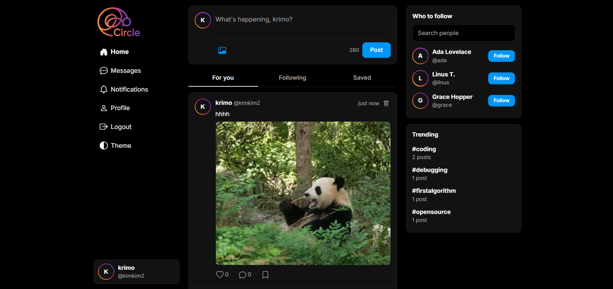
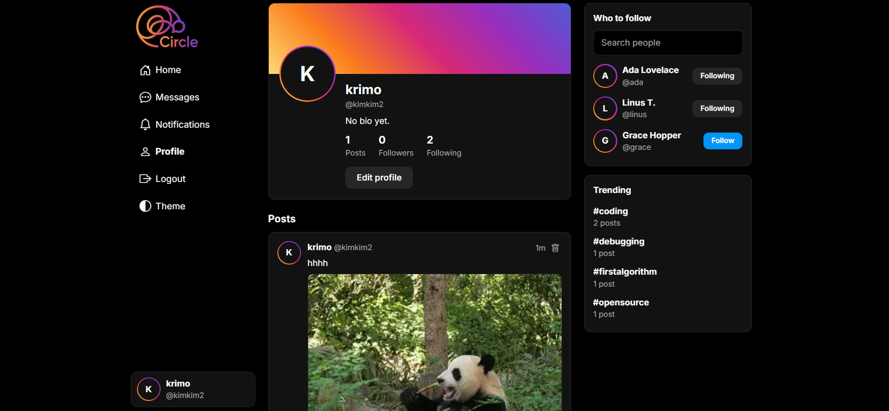
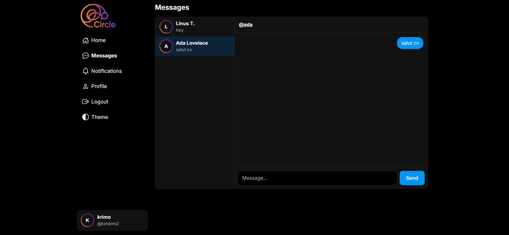
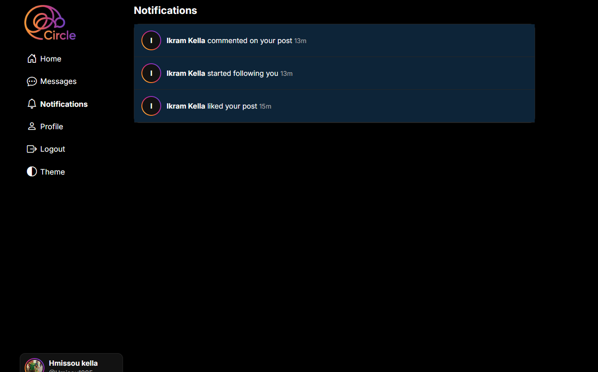

# Circle — Full-Stack Social Media App

> **CodeAlpha Full Stack Development Internship — Task 2: Social Media Platform**

A mini social network: user profiles, posts, comments, likes and a follow system, backed by a real database and a REST API.

## Screenshots

| Feed | Profile |
|---|---|
|  |  |

| Messages | Notifications |
|---|---|
|  |  |

## Features

**Required by the task**
- User profiles (photo, display name, bio, post / follower / following counters, edit profile)
- Posts and comments
- Like and follow system

**Extras**
- Photo posts and profile pictures (resized in the browser, stored in the database)
- Notifications for likes, comments and new followers, with live unread badges
- Private messages (direct messages) with unread counters and auto-refresh
- Hashtags with a trending list and tag pages, `@mentions`
- Saved posts (bookmarks)
- Followers / following lists, user search and "Who to follow" suggestions
- Post permalinks, delete your own posts, delete comments (author or post owner)
- For you / Following / Saved feeds with pagination
- Registration and login (bcrypt + JWT), login with email or username
- Instagram-inspired UI: story-ring avatars, light and dark theme with a toggle, responsive (bottom tab bar on mobile)
- Automated API test suite

## Tech stack

| Layer | Technology |
|---|---|
| Frontend | HTML, CSS, vanilla JavaScript |
| Backend | Node.js, Express.js |
| Database | SQLite (built-in `node:sqlite`) |
| Auth | JSON Web Tokens, bcryptjs |
| Tests | Node's built-in test runner |

## Getting started

**Requirements:** Node.js **22.5 or newer**.

```bash
git clone https://github.com/Kellaikram/CodeAlpha_SocialMediaApp.git
cd CodeAlpha_SocialMediaApp
npm install
npm start
```

Open **http://localhost:3000**. The database (`social.db`) is created on first run with three demo users (`ada`, `linus`, `grace`, password `password123`) and a few posts.

| Variable | Default | Purpose |
|---|---|---|
| `PORT` | `3000` | Server port |
| `JWT_SECRET` | dev value | **Set a long random value in production** |
| `DB_FILE` | `social.db` | SQLite file path |

## Project structure

```
├── server.js              # Express app and route mounting
├── db.js                  # SQLite schema + demo data
├── middleware/auth.js     # JWT sign / requireAuth / optionalAuth
├── lib.js                 # image validation and serving
├── routes/
│   ├── auth.js            # register, login, me
│   ├── users.js           # profiles, avatars, search, follow lists
│   ├── posts.js           # feed, photos, likes, comments, hashtags, saved
│   ├── notifications.js   # notifications and badge counters
│   └── messages.js        # private messages
├── public/                # frontend (home, profile, post, notifications, messages, login)
├── tests/api.test.js
└── screenshots/
```

## Database

`users` · `posts` · `comments` · `likes` · `follows` · `post_tags` · `bookmarks` · `notifications` · `messages`

Foreign keys use `ON DELETE CASCADE`, so deleting a post removes its comments and likes. A `CHECK` constraint stops users from following themselves.

## API

| Method | Route | Auth | Description |
|---|---|---|---|
| POST | `/api/auth/register` | – | Create account |
| POST | `/api/auth/login` | – | Log in (`login` = email or username) |
| GET | `/api/auth/me` | ✔ | Current user |
| GET | `/api/users?q=` | – | Search users / suggestions |
| GET | `/api/users/:username` | – | Profile with counters |
| PUT | `/api/users/me` | ✔ | Edit my name and bio |
| POST / DELETE | `/api/users/:username/follow` | ✔ | Follow / unfollow |
| GET | `/api/posts?feed=&user=&tag=&before=` | – | Feed (`feed=following\|saved` needs auth) |
| POST | `/api/posts` | ✔ | Create a post |
| DELETE | `/api/posts/:id` | ✔ | Delete my post |
| POST / DELETE | `/api/posts/:id/like` | ✔ | Like / unlike |
| GET | `/api/posts/:id/comments` | – | List comments |
| POST | `/api/posts/:id/comments` | ✔ | Add a comment |
| DELETE | `/api/posts/:id/comments/:cid` | ✔ | Delete a comment (author or post owner) |
| GET | `/api/posts/:id` | – | Single post |
| GET | `/api/posts/:id/image` | – | Post photo |
| POST / DELETE | `/api/posts/:id/save` | ✔ | Save / unsave a post |
| GET | `/api/posts/tags/trending` | – | Trending hashtags |
| GET | `/api/users/:username/followers` · `/following` · `/avatar` | – | Lists and profile photo |
| GET | `/api/notifications` · `/count` | ✔ | Notifications and unread counters |
| POST | `/api/notifications/read` | ✔ | Mark all as read |
| GET | `/api/messages` | ✔ | My conversations |
| GET / POST | `/api/messages/:username` | ✔ | Read / send private messages |

## Running the tests

```bash
npm test
```

The suite starts the server on port 3998 with a temporary database and checks authentication, validation, posts, photos, likes, comments, follows, feeds, hashtags, saved posts, notifications, private messages, profile editing, search and permission rules.

## Notes

- For production, move the JWT to httpOnly cookies and add rate limiting and CSRF protection.

## Author

Kella Ikram — CodeAlpha Full Stack Development Intern
LinkedIn: https://www.linkedin.com/in/ikram-kella-113685287?utm_source=share_via&utm_content=profile&utm_medium=member_ios
